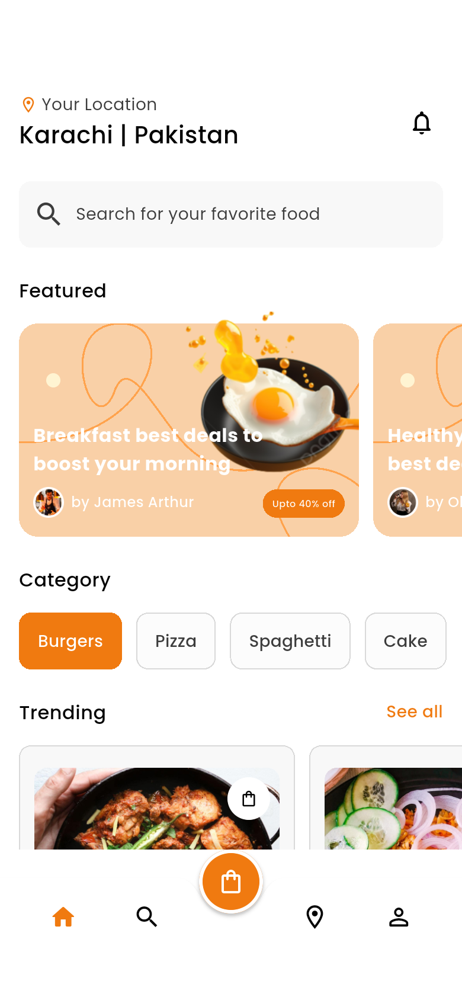
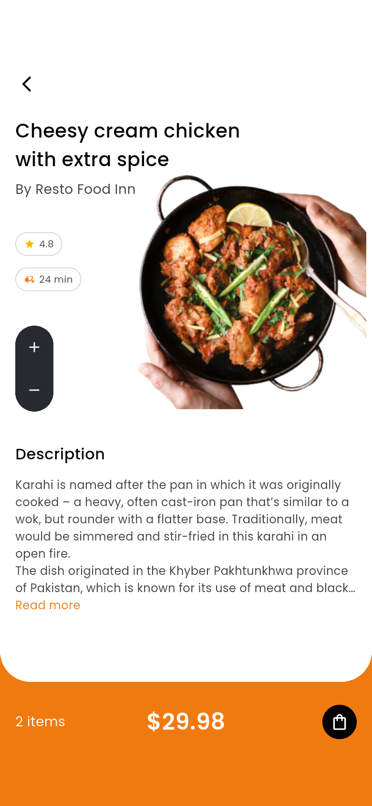
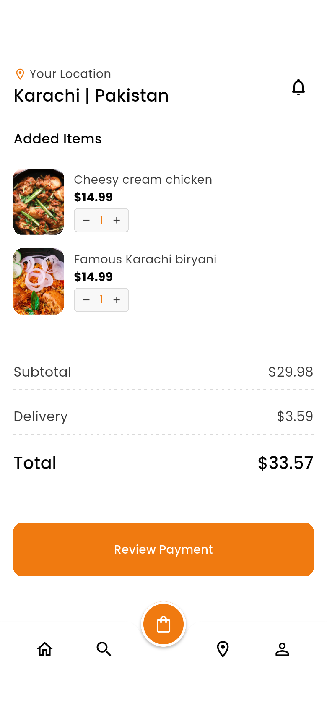
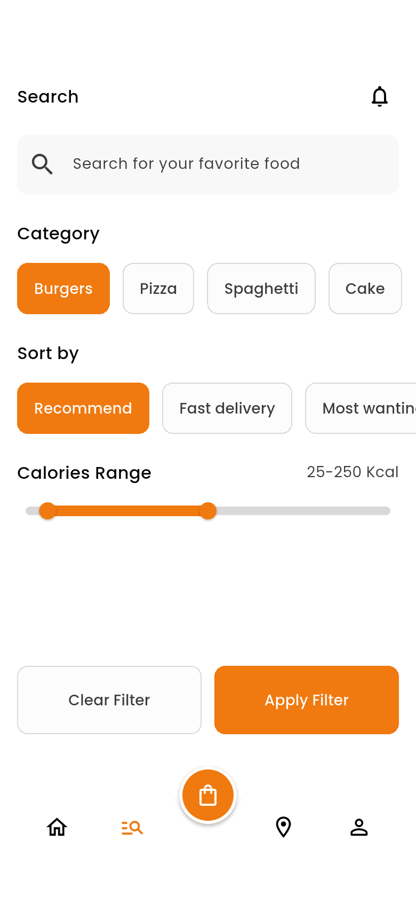
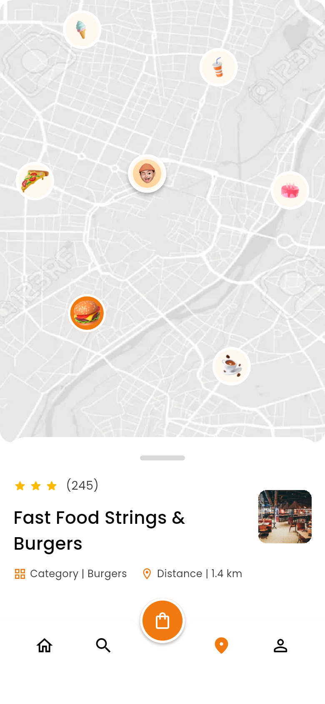
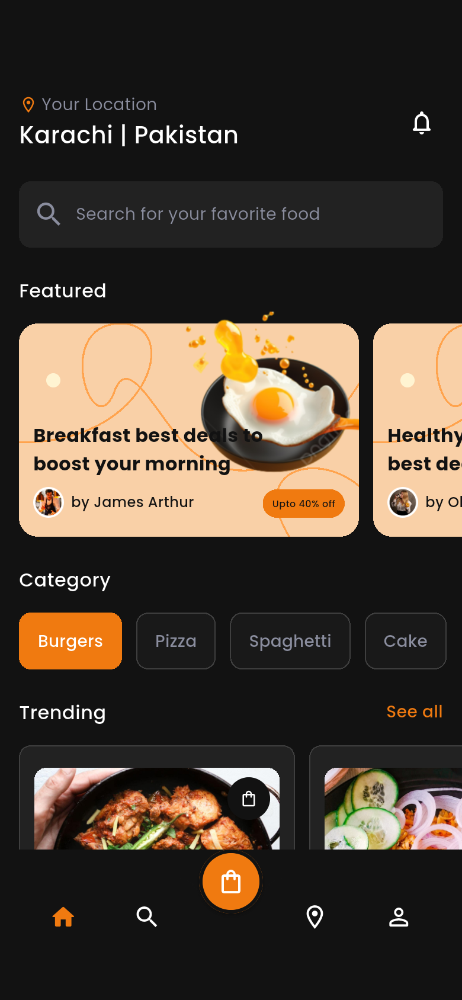

# Hungry Hub · Flutter 外卖 App

根据 Pixso「Hungry Hub」实现的 Android 外卖界面演示。用户可以登录或注册、浏览餐厅和菜品、筛选、调整购物车、选择支付方式与地址，并提交演示订单。浅色与深色共用业务页面，可在 **Profile → Preferences** 切换。

## 主要界面

| 首页 | 菜品详情 | 购物车与费用 |
| --- | --- | --- |
|  |  |  |

| 搜索筛选 | 附近餐厅 | 深色模式 |
| --- | --- | --- |
|  |  |  |

[全部界面截图与 Pixso 画板对应表](docs/SCREENS.md) · [项目架构](docs/ARCHITECTURE.md)

## 项目结构

- `lib/features/` 按认证、发现、账号和结账划分页面。
- `lib/core/` 提供主题、共享组件和会话状态。浅色和深色使用同一套页面。
- `lib/data/` 提供本地菜品、餐厅和地址数据。`assets/` 存放设计素材和字体。

## 在现有 Android 设备运行

```powershell
flutter pub get
flutter devices
flutter run -d emulator-5554
```

从 **Get Started** 进入引导，点击 **Skip** 后选 **LogIn**。可用 `demo@example.com` 和任意至少 6 位的密码登录。注册和找回密码的本地验证码为 `8806`。进入首页后点菜品卡片查看详情，点购物袋加菜，再从底部购物袋进入结账流程。

地点、菜品、配送轨迹和支付方式使用离线演示数据。登录、验证码与下单在本地执行，退出应用后会话和订单状态重置。

## 检查与截图

验证环境为 Flutter 3.47.7、Dart 3.13.5 和 Android 11 x64。Android 工程使用本机可复用的 Gradle 8.14 与 AGP 8.13.1。

```powershell
flutter analyze
flutter test --concurrency=1
pwsh -File tool/capture.ps1 -Device emulator-5554
```

截图脚本复用已运行的 Android 模拟器，按设计稿的 390 × 844 逻辑视口捕获浅色和深色界面，并在运行结束后恢复显示配置。运行前先执行一次 `flutter run` 或 `flutter build apk --debug`，以生成 `android/local.properties`。
